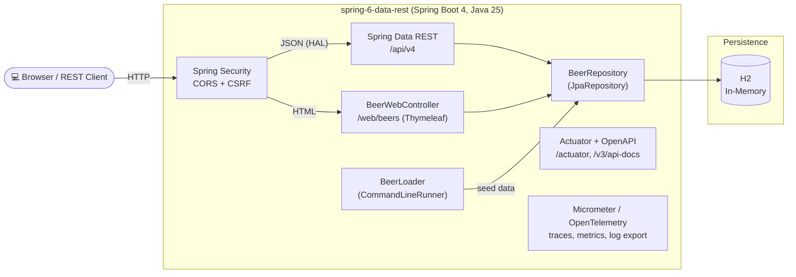
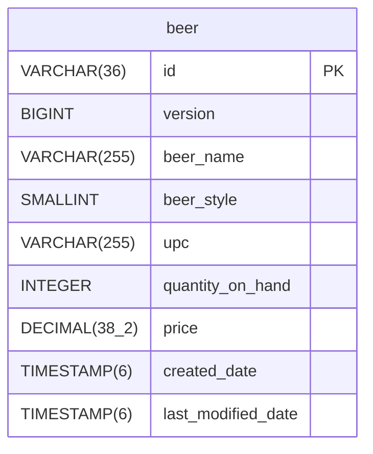
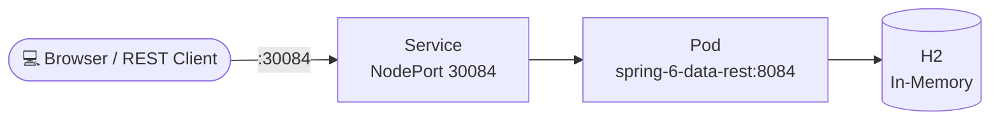

# Spring Data REST API

## Abstract

Spring Boot 4 application (Java 25) exposing a Spring Data REST API for the `Beer` entity under the
base path `/api/v4`. Data is stored in an in-memory H2 database; the API is protected by Spring
Security (CORS, CSRF exemption for the stateless REST API), documented via OpenAPI 3 (springdoc) and
complemented by a Thymeleaf web UI for browsing and editing beers. Deployment is Helm-based
(Kubernetes, port `8084` / NodePort `30084`).

## Architecture Overview



`Customer` currently exists only as a plain POJO (no `@Entity`/repository) and is not exposed by
Spring Data REST.

## Database Schema



## Kubernetes Deployment



## Swagger/Openapi Url

- http://localhost:8084/swagger-ui/index.html
- http://localhost:30084/swagger-ui/index.html

## Web Interface

This application includes a web interface that allows users to interact with the beer data through a browser. The web interface provides the following features:

- View a paginated list of beers
- Navigate through pages of beer listings
- View details of individual beers

To access the web interface, start the application and navigate to:

- http://localhost:8084/web/beers
- http://localhost:30084/web/beers

## Kubernetes

To run maven filtering for destination target/k8s and destination target/helm run:

```bash
mvn clean install -DskipTests 
```

### Deployment with Helm

Be aware that we are using a different namespace here (not default).

Go to the directory where the tgz file has been created after 'mvn install'

```powershell
cd target/helm/repo
```

unpack

```powershell
$file = Get-ChildItem -Filter spring-6-data-rest-chart-*.tgz | Select-Object -First 1
tar -xvf $file.Name
```

install

```powershell
$APPLICATION_NAME = Get-ChildItem -Directory | Where-Object { $_.LastWriteTime -ge $file.LastWriteTime } | Select-Object -ExpandProperty Name
helm upgrade --install $APPLICATION_NAME ./$APPLICATION_NAME --namespace spring-6-data-rest --create-namespace --wait --timeout 5m --debug --render-subchart-notes
```

show logs

```powershell
kubectl get pods -n spring-6-data-rest
```

replace $POD with pods from the command above

```powershell
kubectl logs $POD -n spring-6-data-rest --all-containers
```

Show Endpoints

```powershell
kubectl get endpoints -n sdjpa-intro
```

status

```powershell
helm status $APPLICATION_NAME --namespace spring-6-data-rest
```

test

```powershell
helm test $APPLICATION_NAME --namespace spring-6-data-rest --logs
```

uninstall

```powershell
helm uninstall $APPLICATION_NAME  --namespace spring-6-data-rest
```

delete all

```powershell
kubectl delete all --all -n spring-6-data-rest
```

create busybox sidecar

```powershell
kubectl run busybox-test --rm -it --image=busybox:1.36 --namespace=spring-6-data-rest --command -- sh
```

## Sandbox (local dev environment)

The sandbox consists of the app (Spring Boot, port 8084). H2 is used as in-memory database, so no
external dependency is needed for local development.

### Start the sandbox (opencode-sandbox-kit)

The sandbox is provisioned by the opencode-sandbox-kit and runs as a Docker container. It mounts this
repo, starts opencode, and connects the IntelliJ MCP server.

Allow the kit source (GitHub without cloning):

```powershell
sbx settings set kit.allowedSources --% "[\"docker.io/\",\"codeberg.org/dboeckli/\"]"
```

Start a new sandbox:

```powershell
sbx run opencode `
    --kit "git+https://codeberg.org/dboeckli/opencode-sandbox-kit.git#dir=opencode-agent" `
    --template docker.io/domboeckli/sbx-opencode-tooling:latest `
    --skills=off `
    --static-mcp idea `
    . `
    "C:\development\maven-repo:ro"
```

Start the sandbox with Kubernetes support:

```powershell
sbx run opencode `
    --kit "git+https://codeberg.org/dboeckli/opencode-sandbox-kit.git#dir=opencode-agent" `
    --template docker.io/domboeckli/sbx-opencode-tooling:latest `
    --skills=off `
    --static-mcp idea `
    . `
    "$env:USERPROFILE\.kube:ro" `
    "C:\development\maven-repo:ro"
```

### Start the app

Run the `SfgRestfulBreweryApplication` run configuration in IntelliJ
(`.run/SfgRestfulBreweryApplication.run.xml`, main class
`ch.dboeckli.spring.datarest.SpringApplication`). Alternatively start via
`./mvnw spring-boot:run`.

### Verify

- Swagger UI: http://localhost:8084/swagger-ui/index.html
- OpenAPI json: http://localhost:8084/v3/api-docs
- H2 console: http://localhost:8084/h2-console
- Web interface: http://localhost:8084/web/beers

