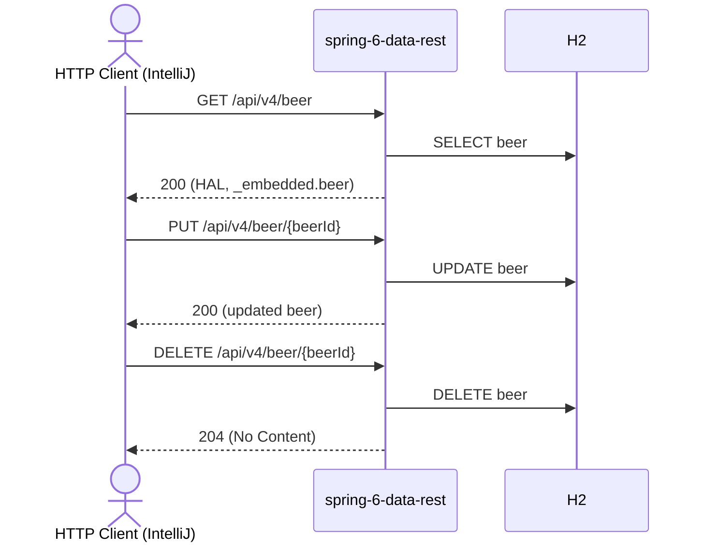

# beer Flow: listBeers → updateBeer → deleteBeer

Datei: `restRequest/beer-flow-list-update-delete/beer-flow-list-update-delete.http`

## Ziel

Ein bestehendes Bier aus der Liste auswählen, vollständig aktualisieren (PUT) und anschließend löschen.

## Ablauf (Services)

## Requests (in dieser Reihenfolge)

1. `listBeers` – speichert `beerId` (erstes Bier aus `_embedded.beer`).
2. `updateBeer` – vollständiges Update (PUT) per `beerId`; das Pre-Request-Skript loggt die benutzte `beerId` und
   wirft einen Fehler, wenn sie nicht gesetzt ist.
3. `deleteBeer` – löscht das Bier per `beerId`.

## Benötigte Globals

|       Global        |         gesetzt von         |        genutzt von         |
|---------------------|-----------------------------|----------------------------|
| `beerId`            | `listBeers`                 | `updateBeer`, `deleteBeer` |
| `traceId`, `spanId` | `../scripts/traceparent.js` | alle Requests              |

## Asserts

- `listBeers` → `200`.
- `updateBeer` → `200`, `beerName` = `Blessed Changed`.
- `deleteBeer` → `204`.

## Hinweise

- Basis-URL ist `{{application-port}}` (Profil `local` = 8084, `k8s` = 30084).
- Spring Data REST liefert die Collection als HAL: `response.body._embedded.beer`.
- PUT ersetzt das Bier vollständig; `id`, `version` und die Timestamps werden vom Server verwaltet und nicht im Body
  gesendet.
- `deleteBeer` liefert `204 No Content`; bei unbekannter `beerId` `404 Not Found`.
- Ohne vorheriges `listBeers` ist `beerId` leer → das Pre-Request wirft einen Fehler.
- CSRF ist für `/api/**` ausgenommen, daher funktionieren POST/PUT/DELETE ohne Token.

