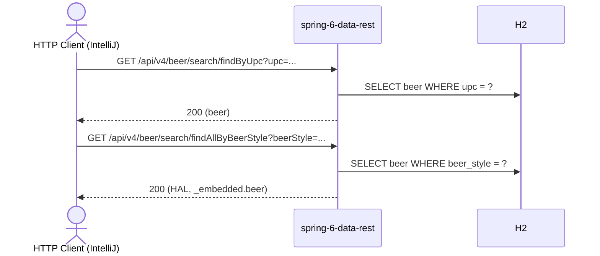

# beer Flow: findByUpc → findAllByBeerStyle

Datei: `restRequest/beer-flow-search/beer-flow-search.md`

## Ziel

Ein Bier über seinen UPC suchen und anschließend alle Biere mit der dabei ermittelten Bier-Sorte (Style) auflisten.

## Ablauf (Services)

## Requests (in dieser Reihenfolge)

1. `findByUpc` – sucht ein Bier per UPC und speichert `beerId` sowie `beerStyle` aus der Antwort.
2. `findAllByBeerStyle` – listet alle Biere mit der in Schritt 1 ermittelten `beerStyle`; das Pre-Request-Skript
   wirft einen Fehler, wenn `beerStyle` nicht gesetzt ist.

## Benötigte Globals

|       Global        |         gesetzt von         |       genutzt von       |
|---------------------|-----------------------------|-------------------------|
| `beerId`            | `findByUpc`                 | (nur Logging/Debugging) |
| `beerStyle`         | `findByUpc`                 | `findAllByBeerStyle`    |
| `traceId`, `spanId` | `../scripts/traceparent.js` | alle Requests           |

## Asserts

- `findByUpc` → `200`, `upc` entspricht der Suchanfrage.
- `findAllByBeerStyle` → `200`, mindestens ein Bier, alle mit der angefragten `beerStyle`.

## Hinweise

- Basis-URL ist `{{application-port}}` (Profil `local` = 8084, `k8s` = 30084).
- Die Suchmethoden stammen aus `BeerRepository` (`findByUpc`, `findAllByBeerStyle`) und werden von Spring Data REST
  automatisch unter `/api/v4/beer/search/` exponiert.
- `findByUpc` liefert ein einzelnes Bier, `findAllByBeerStyle` eine HAL-Collection unter `_embedded.beer`.
- Gültige Styles (`BeerStyleEnum`): `LAGER`, `PILSNER`, `STOUT`, `GOSE`, `PORTER`, `ALE`, `WHEAT`, `IPA`, `PALE_ALE`,
  `SAISON`.
- Der UPC `2380867498485` stammt aus dem Seed-Datensatz (`BeerLoader`).

